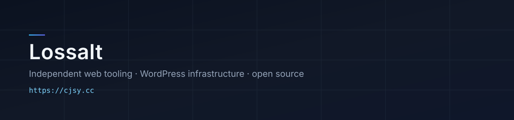

  

# Hi 👋
这里是 **Lossalt**

一个喜欢研究技术的普通人 · 个人站点 [cjsy.cc](https://cjsy.cc/)

---

### 正在学习

### 正在使用

---

### 我的项目

| 项目 | 简介 | 实时状态 |
|---|---|---|
| [**moyue**](https://github.com/Lossalt/moyue) | 墨阅：轻量 Windows / Android EPUB 小说阅读器，支持封面/插图查看，内嵌宋/黑/楷三款字体，原生实现 |    |
| [**article-image**](https://github.com/Lossalt/article-image) | 可搬迁图床：正文写名字，迁站只改 `base_url` |    |
| [**random-img**](https://github.com/Lossalt/random-img) | 随机壁纸接口：图池可拆，302 / 直出 / JSON |    |
| [**iptv-gen**](https://github.com/Lossalt/iptv-gen) | IPTV M3U 生成器：多源采集 + 本机检测 + 清晰度/连通性排序，导出可播放列表（不自带源） |    |
| [**hitokoto-local**](https://github.com/Lossalt/hitokoto-local) | 本地一言：网页管理后台 + 兼容 hitokoto v1 的 API，句库 JSON 热加载 |    |
| [**yi-relay**](https://github.com/Lossalt/yi-relay) | 驿 Relay：对话优先的统一长任务 Agent 入口（Compose 全栈 + 多端同步） |   |

> `yi-relay` 为私有仓库；公开后可换成实时徽章。

### 我参与的项目

按项目归档，括号里是对应的 issue / PR。

| 项目 | 我做的部分 | 实时数据 |
|---|---|---|
| [**Myriad**](https://github.com/Myriad-You/Myriad) 自托管数字生活平台 · Rust + React | 博客站内搜索（[#690](https://github.com/Myriad-You/Myriad/pull/690)）· 笔记外链图片显示（[#692](https://github.com/Myriad-You/Myriad/pull/692)）· 局域网 HTTP 访问白屏修复（[#691](https://github.com/Myriad-You/Myriad/pull/691)）· 分类 / 标签入口与门户（[#687](https://github.com/Myriad-You/Myriad/issues/687)）· 数据卷落到 Compose 目录（[#591](https://github.com/Myriad-You/Myriad/issues/591)）· `zh-TW` 翻译（[#585](https://github.com/Myriad-You/Myriad/pull/585)）· 本地曲库（[#588](https://github.com/Myriad-You/Myriad/pull/588)） |    |
| [**Sakurairo**](https://github.com/mirai-mamori/Sakurairo) WordPress 主题 | 本地曲库 + APlayer 播放加固（[#1429](https://github.com/mirai-mamori/Sakurairo/pull/1429)）· 说说时间轴与归档缓存刷新（[#1430](https://github.com/mirai-mamori/Sakurairo/pull/1430)）· `comment_form` sprintf 崩溃修复（[#1431](https://github.com/mirai-mamori/Sakurairo/pull/1431)） |    |

> Myriad 的 #690 / #691 / #692 已合并进 `preview`；#687 第一档由 [#701](https://github.com/Myriad-You/Myriad/pull/701) 处理中。Sakurairo 三项已进 `preview`。

Lossalt · cjsy.cc · badges refresh on every page view

